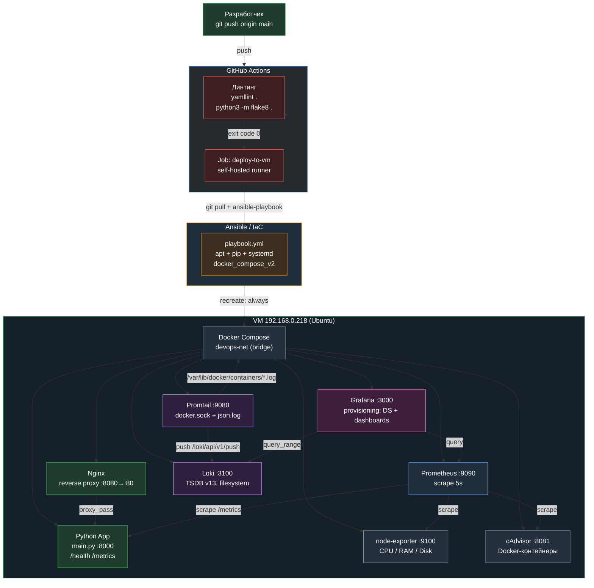

# DevOps-инфраструктура: CI/CD, IaC, Monitoring и Centralized Logging

Пет-проект, демонстрирующий полный цикл работы DevOps-инженера: от линтинга кода и
автоматического развёртывания до сбора метрик и централизованного сбора логов.
Всё разворачивается одной командой `ansible-playbook`, весь пайплайн запускается
по `git push` в ветку `main`.

---

## Архитектура



---

## Компоненты стека и решаемые задачи

### 1. CI/CD — GitHub Actions

Файл `.github/workflows/ci.yml` описывает два job-а:

| Job | Runner | Задача |
|-----|--------|--------|
| `build-and-check` | `ubuntu-latest` | Линтинг: `yamllint .` и `python3 -m flake8 .` |
| `deploy-to-vm` | `self-hosted` | `git pull origin main` + `ansible-playbook -i inventory.ini playbook.yml` |

Ключевая идея: **линтинг — это quality gate**. Job `deploy-to-vm` объявлен с
`needs: build-and-check`, поэтому при ошибке в YAML- или Python-файлах деплой
даже не начнётся. Runner `self-hosted` работает прямо на целевой VM, поэтому
доступ к Docker и Ansible не требует дополнительной настройки.

### 2. IaC — Ansible

`playbook.yml` описывает идемпотиентное приведение VM в нужное состояние:
установка системных пакетов, `pip`-пакета Docker SDK, запуск и включение
сервиса Docker, ожидание готовности демона, создание каталога проекта и,
наконец, `community.docker.docker_compose_v2` с `recreate: always` — полное
пересоздание контейнеров из актуального `docker-compose.yml`.

Тот же playbook используется в двух режимах: вручную для локальной разработки
и в CI для автоматического развёртывания после пуша.

### 3. Monitoring — Prometheus, Node Exporter, cAdvisor, Grafana

- **Prometheus** (`prometheus.yml`) снимает метрики каждые 5 секунд с четырёх
  target-ов: самого себя, `node-exporter`, `cadvisor` и `python-app`.
- **node-exporter** отдаёт метрики хоста: CPU (`node_cpu_seconds_total`),
  память (`node_memory_*`), диск (`node_filesystem_*`).
- **cAdvisor** собирает метрики самих Docker-контейнеров: потребление
  ресурсов, количество рестартов, сетевой и дисковый I/O.
- **Grafana** подключается через **provisioning** (`grafana/provisioning/`) —
  datasource-ы и дашборд `Infrastructure Monitoring` поднимаются
  автоматически, без ручной настройки через UI.

Дашборд состоит из четырёх панелей:

| # | Панель | Тип | Источник |
|---|--------|-----|----------|
| 1 | CPU Usage (%) | timeseries | Prometheus |
| 2 | Memory Usage (%) | timeseries | Prometheus |
| 3 | Disk Available (%) | timeseries | Prometheus |
| 4 | Container Logs (Live) | logs | Loki |

Панель 3 использует универсальную формулу, которая не зависит от конкретных
точек монтирования и исключает `tmpfs`/`overlay`:

```promql
100 - ((node_filesystem_avail_bytes{fstype!~"tmpfs|overlay"} * 100) / node_filesystem_size_bytes{fstype!~"tmpfs|overlay"})
```

### 4. Centralized Logging — Loki + Promtail

- **Promtail** (`promtail-config.yml`) читает JSON-логи всех контейнеров
  напрямую из `/var/lib/docker/containers/*/*-json.log` (через `docker.sock` и
  `docker_sd_configs`), разбирает их pipeline-стадиями `regex` → `timestamp` →
  `output` и отправляет в Loki по адресу `http://loki:3100/loki/api/v1/push`.
- **Loki** (`loki-config.yml`) хранит логи локально: схема `tsdb` версии `v13`,
  `object_store: filesystem`, `kvstore: inmemory` (ring для single-instance
  без внешнего Consul/etcd). Запускается с `-target=all`, чтобы работал
  модуль `querier` — без него query API возвращает 404 и Grafana не может
  ни показать логи, ни пройти тест datasource-а.

### 5. Provisioning — Grafana и Docker

- **Grafana provisioning** (`grafana/provisioning/datasources/datasources.yml`
  и `grafana/provisioning/dashboards/dashboards.yml`) описывает datasource-ы и
  провайдер дашбордов. Дашборд лежит в виде обычного JSON-файла в репозитории
  и версионируется вместе с кодом.
- **Docker Compose** (`docker-compose.yml`) — единое описание всей инфраструктуры:
  образы, порты, тома, healthcheck-и, зависимости и общая bridge-сеть
  `devops-net`.

---

## Приложение: main.py

Минимальное Python-приложение на **только стандартной библиотеке** — без
`flask`, `fastapi` и прочих зависимостей, чтобы сборка образа не усложнялась
и оставалась размером с базовый `python:3.12-slim`.

| Endpoint | Ответ | Код |
|----------|-------|-----|
| `/` | HTML-страница приложения | 200 |
| `/health` | `{"status": "ok"}` | 200 |
| `/metrics` | Метрики в формате Prometheus text exposition | 200 |

Метрики, которые отдаёт `/metrics`:

```
# HELP app_http_requests_total Total number of HTTP requests handled by the application.
# TYPE app_http_requests_total counter
app_http_requests_total 42
# HELP app_uptime_seconds Application uptime in seconds.
# TYPE app_uptime_seconds gauge
app_uptime_seconds 123.456
```

Счётчик запросов защищён `threading.Lock`, поэтому корректно работает при
конкурентных подключениях.

Nginx проксирует все три пути на `python-app:8000`, включая `/health`
и `/metrics`, — это позволяет проверять приложение снаружи контейнера
через единый публичный порт `8080`.

---

## Unit-тестирование и сборка релизных артефактов

ВМ 192.168.0.218 выступает не только средой развёртывания, но и **сборочным
сервером**: код проверяется автотестами и упаковывается в готовый к
распространению релиз.

### Автотесты — `test_main.py`

Тесты написаны на стандартном `unittest` (без внешних зависимостей) и
покрывают три слоя приложения:

| Класс | Что проверяет |
|--------|---------------|
| `MetricsRenderingTests` | Формирование метрик: наличие `HELP`/`TYPE`, числовой тип значений, перевод строки в конце, рост счётчика, потокобезопасность под нагрузкой (20 потоков × 50 инкрементов) |
| `HttpEndpointTests` | Реальные HTTP-запросы к поднятому сокету: коды 200, `Content-Type`, JSON-ответ `{"status": "ok"}`, игнорирование query-строки, текстовый формат Prometheus, HTML-fallback для неизвестных путей, рост счётчика от HTTP-запроса |

```bash
# Полный прогон
python3 -m unittest discover -v

# Только один класс
python3 -m unittest test_main.MetricsRenderingTests -v

# Один тест
python3 -m unittest test_main.HttpEndpointTests.test_health_returns_json_ok -v
```

### Сборка релизного пакета — `build.sh`

Скрипт собирает `dist/app-release.tar.gz` со следующим содержимым:

```
app-release/
├── main.py            # исходный код приложения
├── BUILD_INFO.txt     # метаданные сборки
└── __pycache__/       # скомпилированный байткод Python
```

`BUILD_INFO.txt` фиксирует версию и полную воспроизводимость сборки:

```ini
name: app-release
version: 1.0.0
commit: 4b75d6b9a1c...
commit_short: 4b75d6b
branch: main
commit_date: 2026-10-19T14:38:00+00:00
build_date: 2026-10-19T19:40:12Z
python: Python 3.12.3
```

```bash
# Сборка с автоматическим определением версии и коммита
./build.sh

# Сборка с заданной версией
VERSION=1.2.3 ./build.sh

# Просмотр содержимого архива
tar -tzf dist/app-release.tar.gz
```

### Конвейер сборки в GitHub Actions

Job `build-and-check` выполняет этапы строго последовательно — каждый шаг
является quality gate для следующего:


| Этап | Команда | Что проверяет |
|------|---------|---------------|
| Check YAML syntax | `yamllint .` | Валидность и стиль всех YAML-файлов |
| Check Python syntax | `python3 -m flake8 .` | Стиль и отсутствие ошибок в Python-коде |
| Run unit tests | `python3 -m unittest discover -v` | Логика приложения; при падении сборка не начинается |
| Build application package | `./build.sh` | Сборка `dist/app-release.tar.gz` с метаданными и байткодом |
| Upload build artifact | `actions/upload-artifact@v4` | Прикрепление архива к сборке |

Готовый архив прикрепляется к прогону в GitHub Actions и скачивается
кнопкой **Download artifact** в интерфейсе CI. Job `deploy-to-vm` запускается
только после успешного прохождения `build-and-check`, поэтому сломанный код
никогда не попадает на целевую VM.

---

## Запуск

### Развёртывание одной командой

```bash
cd ~/ansible-test
ansible-playbook -i inventory.ini playbook.yml
```

### Запуск стека вручную

```bash
cd ~/ansible-test
docker compose up -d
docker compose ps
```

### Проверка

```bash
# Health check приложения напрямую и через Nginx
curl -i http://localhost:8000/health
curl -i http://localhost:8080/health

# Метрики приложения
curl -s http://localhost:8080/metrics

# Целевые объекты Prometheus
curl -s http://localhost:9090/api/v1/targets

# Метрики приложения в Prometheus
curl -s -G --data-urlencode 'query=app_http_requests_total' \
  http://localhost:9090/api/v1/query

# Логи контейнеров в Loki
curl -s -G --data-urlencode 'query={job=~".+"}' \
  --data-urlencode 'limit=10' \
  --data-urlencode 'direction=backward' \
  http://localhost:3100/loki/api/v1/query_range

# Статус Loki
curl -s http://localhost:3100/ready
```

### Линтинг и тесты

```bash
yamllint .
python3 -m flake8 .
python3 -m unittest discover -v
```

### Сборка релизного артефакта

```bash
./build.sh
ls -lh dist/app-release.tar.gz
tar -tzf dist/app-release.tar.gz
```

### Доступ к сервисам

| Сервис | Адрес | Логин |
|--------|-------|-------|
| Приложение (через Nginx) | http://localhost:8080 | — |
| Grafana | http://localhost:3000 | `admin` / `admin` |
| Prometheus | http://localhost:9090 | — |
| Loki | http://localhost:3100 | — |
| cAdvisor | http://localhost:8081 | — |
| node-exporter | http://localhost:9100 | — |
| Promtail | http://localhost:9080 | — |

---

## Структура репозитория

```
ansible-test/
├── .github/workflows/ci.yml            # CI/CD: линтинг, тесты, сборка, деплой
├── .flake8                             # Настройки flake8
├── .gitignore                          # Исключения: dist/, __pycache__
├── .yamllint                           # Настройки yamllint
├── build.sh                            # Сборка релизного пакета dist/app-release.tar.gz
├── Dockerfile                          # Образ Python-приложения
├── docker-compose.yml                  # Оркестрация всех сервисов
├── inventory.ini                       # Ansible inventory
├── ansible.cfg                         # Конфигурация Ansible
├── main.py                             # Python-приложение (/health, /metrics)
├── test_main.py                        # Unit-тесты приложения (unittest)
├── nginx.conf                          # Reverse proxy
├── playbook.yml                        # IaC: развёртывание + smoke-тест
├── prometheus.yml                      # Targets для Prometheus
├── loki-config.yml                     # Конфигурация Loki
├── promtail-config.yml                 # Сбор логов контейнеров
└── grafana/provisioning/
    ├── datasources/datasources.yml     # Prometheus + Loki datasource
    └── dashboards/
        ├── dashboards.yml               # Провайдер дашбордов
        └── infra-monitoring.json       # Дашборд с 4 панелями
```

---

## Технологии

**Python** · **Ansible** · **Docker / Docker Compose** · **Nginx** · **Prometheus** ·
**Grafana** · **Loki** · **Promtail** · **node-exporter** · **cAdvisor** ·
**GitHub Actions** · **yamllint** · **flake8** · **unittest**
