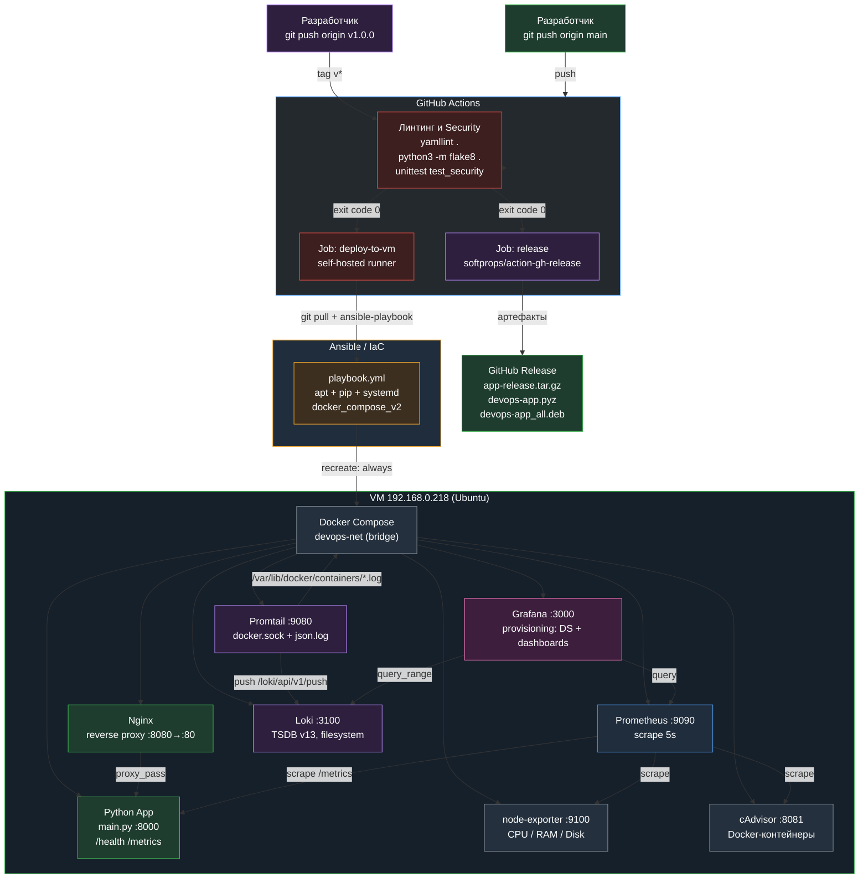
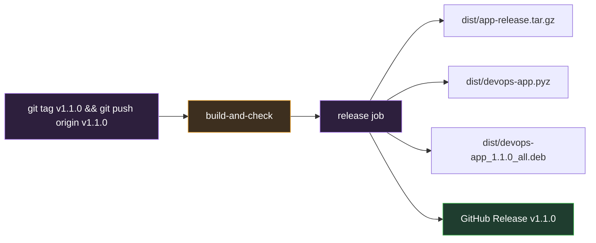

# DevOps-инфраструктура: CI/CD, IaC, Monitoring и Centralized Logging

Пет-проект, демонстрирующий полный цикл работы DevOps-инженера: от линтинга кода и
автоматического развёртывания до сбора метрик и централизованного сбора логов.
Всё разворачивается одной командой `ansible-playbook`, весь пайплайн запускается
по `git push` в ветку `main`.

---

## Архитектура



---

## Компоненты стека и решаемые задачи

### 1. CI/CD — GitHub Actions

Файл `.github/workflows/ci.yml` описывает три job-а:

| Job | Runner | Задача |
|-----|--------|--------|
| `build-and-check` | `ubuntu-latest` | Линтинг, security-тесты, unit-тесты, сборка и загрузка артефакта |
| `deploy-to-vm` | `self-hosted` | `git pull origin main` + `ansible-playbook -i inventory.ini playbook.yml` |
| `release` | `ubuntu-latest` | Публикация GitHub Release по тегу версии `v*` |

Ключевая идея: **линтинг и security-тесты — это quality gate**. Job
`deploy-to-vm` объявлен с `needs: build-and-check`, поэтому при ошибке в
YAML-, Python-файлах или при обнаружении секретов деплой даже не начнётся.
Runner `self-hosted` работает прямо на целевой VM, поэтому доступ к Docker и
Ansible не требует дополнительной настройки.

### 2. IaC — Ansible

`playbook.yml` описывает идемпотиентное приведение VM в нужное состояние:
установка системных пакетов, `pip`-пакета Docker SDK, запуск и включение
сервиса Docker, ожидание готовности демона, создание каталога проекта и,
наконец, `community.docker.docker_compose_v2` с `recreate: always` — полное
пересоздание контейнеров из актуального `docker-compose.yml`.

Тот же playbook используется в двух режимах: вручную для локальной разработки
и в CI для автоматического развёртывания после пуша.

### 3. Monitoring — Prometheus, Node Exporter, cAdvisor, Grafana

- **Prometheus** (`prometheus.yml`) снимает метрики каждые 5 секунд с четырёх
  target-ов: самого себя, `node-exporter`, `cadvisor` и `python-app`.
- **node-exporter** отдаёт метрики хоста: CPU (`node_cpu_seconds_total`),
  память (`node_memory_*`), диск (`node_filesystem_*`).
- **cAdvisor** собирает метрики самих Docker-контейнеров: потребление
  ресурсов, количество рестартов, сетевой и дисковый I/O.
- **Grafana** подключается через **provisioning** (`grafana/provisioning/`) —
  datasource-ы и дашборд `Infrastructure Monitoring` поднимаются
  автоматически, без ручной настройки через UI.

Дашборд состоит из четырёх панелей:

| # | Панель | Тип | Источник |
|---|--------|-----|----------|
| 1 | CPU Usage (%) | timeseries | Prometheus |
| 2 | Memory Usage (%) | timeseries | Prometheus |
| 3 | Disk Available (%) | timeseries | Prometheus |
| 4 | Container Logs (Live) | logs | Loki |

Панель 3 использует универсальную формулу, которая не зависит от конкретных
точек монтирования и исключает `tmpfs`/`overlay`:

```promql
100 - ((node_filesystem_avail_bytes{fstype!~"tmpfs|overlay"} * 100) / node_filesystem_size_bytes{fstype!~"tmpfs|overlay"})
```

#### Правила алертинга — `alert_rules.yml`

Prometheus оценивает правила из файла `alert_rules.yml`, подключённого через
`rule_files` в `prometheus.yml` и смонтированного в контейнер в режиме
read-only. Группа правил называется `infrastructure_alerts`:

| Алерт | Условие | Длительность | Severity | Что означает |
|-------|---------|--------------|----------|--------------|
| `AppDown` | `up{job="python-app"} == 0` | `1m` | `critical` | Приложение не отвечает: target `python-app:8000` недоступен дольше минуты |
| `HighCpuLoad` | `100 - (avg by (instance) (rate(node_cpu_seconds_total{mode="idle"}[5m])) * 100) > 85` | `2m` | `warning` | Загрузка CPU выше 85% дольше двух минут |
| `LowDiskSpace` | `(node_filesystem_avail_bytes{fstype!~"tmpfs|overlay"} / node_filesystem_size_bytes{fstype!~"tmpfs|overlay"}) * 100 < 15` | `5m` | `warning` | Доступно меньше 15% дискового пространства |

Проверить, что правила загружены и активны:

```bash
# Все правила в виде JSON
curl -s http://localhost:9090/api/v1/rules | python3 -m json.tool

# Только имена алертов и их состояние
curl -s http://localhost:9090/api/v1/rules | python3 -c "
import json, sys
data = json.load(sys.stdin)
for group in data['data']['groups']:
    print(group['name'])
    for rule in group['rules']:
        print('  ', rule['name'], rule['state'], rule.get('duration', 0))
"

# Сработавшие (firing) алерты
curl -s http://localhost:9090/api/v1/alerts
```

Правила покрыты автотестами `test_alerts.py`: они проверяют наличие всех трёх
алертов, корректность полей `alert`, `expr`, `for`, `labels.severity`,
`annotations.summary`, а также подключение файла правил в `prometheus.yml` и
проброс в контейнер в `docker-compose.yml`.

### 4. Centralized Logging — Loki + Promtail

- **Promtail** (`promtail-config.yml`) читает JSON-логи всех контейнеров
  напрямую из `/var/lib/docker/containers/*/*-json.log` (через `docker.sock` и
  `docker_sd_configs`), разбирает их pipeline-стадиями `regex` → `timestamp` →
  `output` и отправляет в Loki по адресу `http://loki:3100/loki/api/v1/push`.
- **Loki** (`loki-config.yml`) хранит логи локально: схема `tsdb` версии `v13`,
  `object_store: filesystem`, `kvstore: inmemory` (ring для single-instance
  без внешнего Consul/etcd). Запускается с `-target=all`, чтобы работал
  модуль `querier` — без него query API возвращает 404 и Grafana не может
  ни показать логи, ни пройти тест datasource-а.

### 5. Provisioning — Grafana и Docker

- **Grafana provisioning** (`grafana/provisioning/datasources/datasources.yml`
  и `grafana/provisioning/dashboards/dashboards.yml`) описывает datasource-ы и
  провайдер дашбордов. Дашборд лежит в виде обычного JSON-файла в репозитории
  и версионируется вместе с кодом.
- **Аутентификация Grafana**: автологин отключён
  (`GF_AUTH_AUTO_LOGIN_ENABLED=false`), а пароль администратора задаётся
  переменной окружения `GF_SECURITY_ADMIN_PASSWORD` (значение по умолчанию
  `admin` используется только на локальном стенде).
- **Docker Compose** (`docker-compose.yml`) — единое описание всей инфраструктуры:
  образы, порты, тома, healthcheck-и, зависимости и общая bridge-сеть
  `devops-net`.

---

## Приложение: main.py

Минимальное Python-приложение на **только стандартной библиотеке** — без
`flask`, `fastapi` и прочих зависимостей, чтобы сборка образа не усложнялась
и оставалась размером с базовый `python:3.12-slim`.

| Endpoint | Ответ | Код |
|----------|-------|-----|
| `/` | HTML-страница приложения | 200 |
| `/health` | `{"status": "ok"}` | 200 |
| `/metrics` | Метрики в формате Prometheus text exposition | 200 |

Метрики, которые отдаёт `/metrics`:

```
# HELP app_http_requests_total Total number of HTTP requests handled by the application.
# TYPE app_http_requests_total counter
app_http_requests_total 42
# HELP app_uptime_seconds Application uptime in seconds.
# TYPE app_uptime_seconds gauge
app_uptime_seconds 123.456
```

Счётчик запросов защищён `threading.Lock`, поэтому корректно работает при
конкурентных подключениях.

Точка входа приложения — функция `main()`, а адрес и порт можно переопределить
переменными окружения `APP_HOST` и `APP_PORT` (по умолчанию `0.0.0.0:8000`).
Именно `main:main` используется как точка входа zipapp-артефакта
`devops-app.pyz`.

Nginx проксирует все три пути на `python-app:8000`, включая `/health`
и `/metrics`, — это позволяет проверять приложение снаружи контейнера
через единый публичный порт `8080`.

---

## Unit-тестирование и сборка релизных артефактов

ВМ 192.168.0.218 выступает не только средой развёртывания, но и **сборочным
сервером**: код проверяется автотестами и упаковывается в готовый к
распространению релиз.

### Автотесты — `test_main.py`

Тесты написаны на стандартном `unittest` (без внешних зависимостей) и
покрывают три слоя приложения:

| Класс | Что проверяет |
|--------|---------------|
| `MetricsRenderingTests` | Формирование метрик: наличие `HELP`/`TYPE`, числовой тип значений, перевод строки в конце, рост счётчика, потокобезопасность под нагрузкой (20 потоков × 50 инкрементов) |
| `HttpEndpointTests` | Реальные HTTP-запросы к поднятому сокету: коды 200, `Content-Type`, JSON-ответ `{"status": "ok"}`, игнорирование query-строки, текстовый формат Prometheus, HTML-fallback для неизвестных путей, рост счётчика от HTTP-запроса |

```bash
# Полный прогон
python3 -m unittest discover -v

# Только один класс
python3 -m unittest test_main.MetricsRenderingTests -v

# Один тест
python3 -m unittest test_main.HttpEndpointTests.test_health_returns_json_ok -v
```

### Сборка релизных пакетов — `build.sh`

Скрипт собирает сразу **три настоящих релизных формата**:

| Артефакт | Формат | Назначение |
|----------|--------|------------|
| `dist/app-release.tar.gz` | tar-архив | Исходники, метаданные сборки и скомпилированный байткод |
| `dist/devops-app.pyz` | zipapp | Единый исполняемый файл: `./devops-app.pyz` — и приложение работает |
| `dist/devops-app_1.0.0_all.deb` | Debian/Ubuntu | Устанавливаемый пакет с systemd-юнитом |

#### 1. Архив исходников — `dist/app-release.tar.gz`

```
app-release/
├── main.py            # исходный код приложения
├── BUILD_INFO.txt     # метаданные сборки
└── __pycache__/       # скомпилированный байткод Python
```

`BUILD_INFO.txt` фиксирует версию и полную воспроизводимость сборки:

```ini
name: app-release
version: 1.0.0
commit: 4b75d6b9a1c...
commit_short: 4b75d6b
branch: main
commit_date: 2026-10-19T14:38:00+00:00
build_date: 2026-10-19T19:40:12Z
python: Python 3.12.3
```

#### 2. Standalone executable — `dist/devops-app.pyz`

Собирается штатным модулем `python3 -m zipapp` с shebang
`#!/usr/bin/env python3` и точкой входа `main:main`. Файл запускается
напрямую, без установки и без внешних зависимостей:

```bash
chmod +x dist/devops-app.pyz
./dist/devops-app.pyz          # поднимает сервер на 0.0.0.0:8000
curl -s http://localhost:8000/health
```

Порт и адрес можно переопределить переменными окружения `APP_PORT` и
`APP_HOST` — этим пользуются автотесты, чтобы поднять несколько копий
приложения одновременно.

#### 3. Установочный пакет Debian/Ubuntu — `dist/devops-app_1.0.0_all.deb`

Пакет собирается утилитой `dpkg-deb --build` из настоящей структуры
Debian-пакета:

```
DEBIAN/
├── control             # метаданные пакета (Package, Version, Architecture...)
├── md5sums             # контрольные суммы устанавливаемых файлов
└── postinst            # создаёт пользователя devops-app и перечитывает unit-ы
etc/systemd/system/
└── devops-app.service  # unit-файл systemd
opt/devops-app/
├── main.py             # приложение
└── BUILD_INFO.txt      # метаданные сборки
usr/local/bin/
└── devops-app          # исполняемый лаунчер
```

Установка пакета:

```bash
# Установить пакет
sudo dpkg -i dist/devops-app_1.0.0_all.deb

# Проверить состояние пакета
dpkg -l devops-app

# Метаданные и состав пакета
dpkg-deb --info dist/devops-app_1.0.0_all.deb
dpkg-deb --contents dist/devops-app_1.0.0_all.deb

# Запустить как сервис
sudo systemctl daemon-reload
sudo systemctl enable --now devops-app
curl -s http://localhost:8000/health

# Удалить
sudo dpkg -r devops-app
```

Сервис запускается от непривилегированного пользователя `devops-app`,
которого создаёт `postinst`, и работает с hardening-опциями systemd
(`NoNewPrivileges`, `ProtectSystem=strict`, `ProtectHome`).

#### Команды сборки

```bash
# Сборка с автоматическим определением версии и коммита
./build.sh

# Сборка с заданной версией (имя .deb-пакета строится из неё)
VERSION=1.2.3 ./build.sh

# Просмотр содержимого артефактов
tar -tzf dist/app-release.tar.gz
unzip -l dist/devops-app.pyz
dpkg-deb --contents dist/devops-app_1.0.0_all.deb
```

### Тесты сборочного конвейера — `test_build.py`

Отдельный набор автотестов проверяет сам сборочный конвейер:

| Класс | Что проверяет |
|--------|---------------|
| `BuildArtifactsTests` | `build.sh` завершается с кодом 0 и создаёт все три артефакта (`.tar.gz`, `.pyz`, `.deb`) |
| `TarballContentTests` | В tar-архиве есть `main.py`, `BUILD_INFO.txt` с номером коммита и скомпилированный байткод |
| `ZipappArtifactTests` | Shebang `#!/usr/bin/env python3`, права на исполнение, точка входа `main:main` и фактический запуск `.pyz` с проверкой `/health` |
| `DebianPackageTests` | `dpkg-deb --info` возвращает корректные метаданные пакета, а `dpkg-deb --contents` — лаунчер, systemd-юнит и приложение |

```bash
# Только тесты сборки
python3 -m unittest test_build -v

# Все тесты проекта
python3 -m unittest discover -v
```

### Конвейер сборки в GitHub Actions

Job `build-and-check` выполняет этапы строго последовательно — каждый шаг
является quality gate для следующего:


| Этап | Команда | Что проверяет |
|------|---------|---------------|
| Check YAML syntax | `yamllint .` | Валидность и стиль всех YAML-файлов |
| Check Python syntax | `python3 -m flake8 .` | Стиль и отсутствие ошибок в Python-коде |
| Run security tests | `python3 -m unittest test_security -v` | Секреты и практики безопасности; при нарушении сборка не начинается |
| Run unit tests | `python3 -m unittest discover -v` | Логика приложения и сборочного конвейера; при падении сборка не начинается |
| Build application package | `./build.sh` | Сборка трёх форматов: `app-release.tar.gz`, `devops-app.pyz`, `devops-app_<version>_all.deb` |
| Upload build artifact | `actions/upload-artifact@v4` | Прикрепление всех артефактов из `dist/` к сборке |

Все готовые файлы прикрепляются к прогону в GitHub Actions и скачиваются
кнопкой **Download artifact** в интерфейсе CI. Job `deploy-to-vm` запускается
только после успешного прохождения `build-and-check`, поэтому сломанный код
никогда не попадает на целевую VM.

---

## DevSecOps: проверки безопасности

Файл `test_security.py` добавляет в конвейер автоматический контроль
безопасности. Тесты написаны **только на стандартной библиотеке**, поэтому
запускаются без установки `bandit`, `trivy` или любых других зависимостей —
на локальной машине, на CI-раннере и на целевой VM.

```bash
# Только security-тесты
python3 -m unittest test_security -v

# Все тесты проекта (unit + security)
python3 -m unittest discover -v
```

### Что проверяется

| Класс | Проверка |
|--------|----------|
| `SecretScanningTests` | Приватные ключи (PEM-блоки, в том числе `BEGIN OPENSSH PRIVATE KEY`), токены GitHub (classic и fine-grained), ключи AWS, токены Slack и OpenAI, JWT и захардкоженные пароли в файлах репозитория |
| `DockerComposeSecurityTests` | Запрет `privileged: true` и `network_mode: host`, отсутствие опасных Linux capabilities, секреты только через переменные окружения, отключённый автологин Grafana, монтирования каталогов хоста в режиме read-only, наличие healthcheck у сервиса приложения |
| `DockerfileSecurityTests` | Фиксация версии базового образа, запуск от непривилегированного пользователя, запрет `ADD` с внешним URL, отсутствие секретов в `ENV`/`ARG`, наличие `HEALTHCHECK`, исключение `.git` из контекста сборки через `.dockerignore` |
| `PipelinePolicyTests` | Security-тесты запускаются **до** сборки, релиз публикуется по тегу `v*`, у job-а релиза есть права `contents: write` |

Секреты считаются таковыми, если значение **не** является ссылкой на переменную
окружения (`${VAR}`, `${{ secrets.X }}`, `{{ var }}`). Допустимые исключения
перечислены в `PLACEHOLDER_VALUES` — это значения-заглушки (`changeme`,
`example`, `admin` и т. п.), которые в pet-проекте заменяются переменными
окружения.

### Что сделано в инфраструктуре

| Проблема | Решение |
|----------|---------|
| Приложение работало от root | В `Dockerfile` добавлен непривилегированный пользователь `appuser` (uid 10001) и инструкция `USER` |
| Пароль Grafana был зашит в `docker-compose.yml` | `GF_SECURITY_ADMIN_PASSWORD` читается из переменной окружения (`${GF_SECURITY_ADMIN_PASSWORD:-admin}`) |
| Grafana была доступна без аутентификации | `GF_AUTH_AUTO_LOGIN_ENABLED=false` — вход выполняется под учётной записью `admin` |
| Каталоги хоста монтировались в режиме read-write | Все конфиги и каталоги смонтированы с `:ro`; read-write оставлен только там, где это требуется по назначению (`docker.sock` и `/var/lib/docker` для Promtail) |
| В образ попадал каталог `.git` | Добавлен `.dockerignore` |
| Promtail падал с `config file does not exist` | Конфиг Promtail теперь монтируется в контейнер: `./promtail-config.yml:/etc/promtail/promtail-config.yml:ro` |

### Ручная проверка перед коммитом

```bash
yamllint .
python3 -m flake8 .
python3 -m unittest test_security -v
python3 -m unittest test_build -v
python3 -m unittest test_alerts -v
python3 -m unittest discover -v
```

---

## Релизы

Релизы публикуются автоматически по тегу версии. Workflow
`.github/workflows/ci.yml` содержит триггер `tags: ["v*"]` и отдельный job
`release`, который собирает пакет с версией из тега и публикует GitHub Release
через `softprops/action-gh-release@v2` с автогенерацией Release Notes.



### Что попадает в релиз

| Файл | Описание |
|------|----------|
| `dist/app-release.tar.gz` | Архив с `main.py`, `BUILD_INFO.txt` и скомпилированным байткодом |
| `dist/devops-app.pyz` | Standalone executable: запускается как `./devops-app.pyz` |
| `dist/devops-app_<version>_all.deb` | Устанавливаемый пакет Debian/Ubuntu с systemd-юнитом |
| `dist/BUILD_INFO.txt` | Те же метаданные сборки отдельным файлом (версия, коммит, ветка, дата, версия Python) |

Номер версии в имени `.deb`-пакета берётся из тега: для тега `v1.1.0`
собирается `devops-app_1.1.0_all.deb`.

### Порядок выпуска

```bash
cd ~/ansible-test

# 1. Прогнать все проверки локально
yamllint . && python3 -m flake8 . && python3 -m unittest discover -v

# 2. Зафиксировать изменения и отправить их в main
git add .
git commit -m "Build three release formats and publish them in GitHub Releases"
git push origin main

# 3. Создать и отправить тег версии
git tag -a v1.1.0 -m "Release v1.1.0"
git push origin v1.1.0

# 4. Убедиться, что релиз опубликован
gh release view v1.1.0 --json tagName,url,assets
```

Тег `v*` запускает полный конвейер: линтинг → security-тесты → unit-тесты →
сборка → деплой на VM → публикация GitHub Release. Если хотя бы один
quality-gate не пройден, релиз не создаётся.

---

## Публикация Docker-образа в GitHub Container Registry

Job `build-and-check` после сборки артефактов публикует образ приложения в
**GitHub Container Registry (ghcr.io)**. Для этого у job-а есть разрешение
`packages: write`, а логин выполняется официальным экшеном
`docker/login-action@v3` с токеном `${{ secrets.GITHUB_TOKEN }}`.

Образ публикуется под двумя тегами:

| Тег | Назначение |
|-----|------------|
| `ghcr.io/pieaceton/first-devops-project:latest` | Последний образ из `main` |
| `ghcr.io/pieaceton/first-devops-project:<short-sha>` | Образ конкретного коммита (7 символов SHA) |

```yaml
- name: Login to GitHub Container Registry
  uses: docker/login-action@v3
  with:
    registry: ghcr.io
    username: ${{ github.actor }}
    password: ${{ secrets.GITHUB_TOKEN }}

- name: Resolve image tags
  id: image
  run: |
    SHORT_SHA="$(git rev-parse --short HEAD)"
    {
      echo "short_sha=${SHORT_SHA}"
      echo "tags<<EOF"
      echo "ghcr.io/pieaceton/first-devops-project:latest"
      echo "ghcr.io/pieaceton/first-devops-project:${SHORT_SHA}"
      echo "EOF"
    } >> "$GITHUB_OUTPUT"

- name: Build and push image to GitHub Container Registry
  uses: docker/build-push-action@v6
  with:
    context: .
    push: true
    tags: ${{ steps.image.outputs.tags }}
```

### Использование образа

```bash
# Публичный образ из реестра
docker pull ghcr.io/pieaceton/first-devops-project:latest

# Образ конкретного коммита
docker pull ghcr.io/pieaceton/first-devops-project:c69a42a

# Запуск
docker run --rm -p 8000:8000 ghcr.io/pieaceton/first-devops-project:latest
curl -s http://localhost:8000/health
```

Пакеты реестра доступны по адресу https://github.com/Pieaceton/first-devops-project/pkgs/container/first-devops-project

---

## Запуск

### Развёртывание одной командой

```bash
cd ~/ansible-test
ansible-playbook -i inventory.ini playbook.yml
```

### Запуск стека вручную

```bash
cd ~/ansible-test
docker compose up -d
docker compose ps
```

### Проверка

```bash
# Health check приложения напрямую и через Nginx
curl -i http://localhost:8000/health
curl -i http://localhost:8080/health

# Метрики приложения
curl -s http://localhost:8080/metrics

# Целевые объекты Prometheus
curl -s http://localhost:9090/api/v1/targets

# Метрики приложения в Prometheus
curl -s -G --data-urlencode 'query=app_http_requests_total' \
  http://localhost:9090/api/v1/query

# Логи контейнеров в Loki
curl -s -G --data-urlencode 'query={job=~".+"}' \
  --data-urlencode 'limit=10' \
  --data-urlencode 'direction=backward' \
  http://localhost:3100/loki/api/v1/query_range

# Статус Loki
curl -s http://localhost:3100/ready
```

### Линтинг и тесты

```bash
yamllint .
python3 -m flake8 .
python3 -m unittest test_security -v
python3 -m unittest test_build -v
python3 -m unittest test_alerts -v
python3 -m unittest discover -v
```

### Сборка релизных артефактов

```bash
./build.sh
ls -lh dist/app-release.tar.gz dist/devops-app.pyz dist/devops-app_*.deb
tar -tzf dist/app-release.tar.gz
unzip -l dist/devops-app.pyz
dpkg-deb --info dist/devops-app_1.0.0_all.deb
```

### Доступ к сервисам

| Сервис | Адрес | Логин |
|--------|-------|-------|
| Приложение (через Nginx) | http://localhost:8080 | — |
| Grafana | http://localhost:3000 | `admin` / `admin` |
| Prometheus | http://localhost:9090 | — |
| Loki | http://localhost:3100 | — |
| cAdvisor | http://localhost:8081 | — |
| node-exporter | http://localhost:9100 | — |
| Promtail | http://localhost:9080 | — |

Релизы и артефакты сборки публикуются в GitHub Releases: https://github.com/Pieaceton/first-devops-project/releases

---

## Структура репозитория

```
ansible-test/
├── .github/workflows/ci.yml            # CI/CD: линтинг, security-тесты, сборка, деплой, релиз
├── .dockerignore                       # Исключения контекста сборки образа (.git, dist, ...)
├── .flake8                             # Настройки flake8
├── .gitignore                          # Исключения: dist/, __pycache__
├── .yamllint                           # Настройки yamllint
├── build.sh                            # Сборка 3 релизных форматов: tar.gz, .pyz, .deb
├── Dockerfile                          # Образ Python-приложения (непривилегированный пользователь)
├── docker-compose.yml                  # Оркестрация всех сервисов
├── inventory.ini                       # Ansible inventory
├── ansible.cfg                         # Конфигурация Ansible
├── main.py                             # Python-приложение (/health, /metrics)
├── test_main.py                        # Unit-тесты приложения (unittest)
├── test_build.py                       # Тесты сборочного конвейера (tar.gz, .pyz, .deb)
├── test_alerts.py                      # Тесты правил алертинга Prometheus
├── test_security.py                    # DevSecOps-тесты: секреты и безопасность конфигурации
├── nginx.conf                          # Reverse proxy
├── playbook.yml                        # IaC: развёртывание + smoke-тест
├── prometheus.yml                      # Targets для Prometheus + подключение правил
├── alert_rules.yml                     # Правила алертинга Prometheus (infrastructure_alerts)
├── loki-config.yml                     # Конфигурация Loki
├── promtail-config.yml                 # Сбор логов контейнеров
└── grafana/provisioning/
    ├── datasources/datasources.yml     # Prometheus + Loki datasource
    └── dashboards/
        ├── dashboards.yml               # Провайдер дашбордов
        └── infra-monitoring.json       # Дашборд с 4 панелями
```

---

## Технологии

**Python** · **Ansible** · **Docker / Docker Compose** · **Nginx** · **Prometheus** ·
**Grafana** · **Loki** · **Promtail** · **node-exporter** · **cAdvisor** ·
**GitHub Actions** · **yamllint** · **flake8** · **unittest** · **GitHub Releases**

## HTTPS-доступ и защита от DDoS

Nginx принимает HTTPS-трафик на порту 8443 (маппинг 8443:443).
SSL-сертификаты (cert.pem, key.pem) генерируются автоматически при старте контейнера.

Защита от DDoS реализована через `limit_req_zone` (10 r/s на IP) с burst=20.
